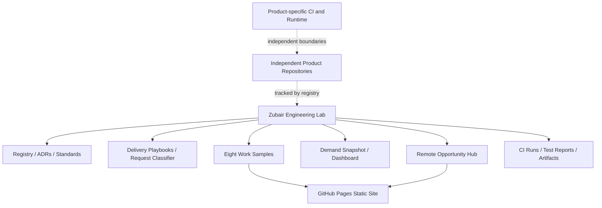

# Zubair Engineering Lab

[](https://www.python.org/)
[](https://pages.github.com/)
[](portfolio/README.md)
[](#proof-of-concept--enterprise-customization-readiness)

**A portfolio-level engineering control plane, delivery laboratory, and evidence-backed work-sample hub.**

Zubair Engineering Lab organizes independent product repositories, engineering standards, delivery playbooks, CI evidence, reusable work samples, demand research, and a zero-budget remote-opportunity directory. It is a governance and integration layer—not a monolithic application and not a claim that every listed project is production-ready.

## 1. Project Overview & Problem Statement

A growing software portfolio can accumulate repositories, frameworks, prototypes, and automation without a reliable view of what is actually implemented, tested, deployable, or reusable. At the same time, service delivery needs repeatable scopes, acceptance checks, and evidence that can be shown without claiming unperformed client work.

The lab addresses this by providing:

- A declarative project registry and evidence-based capability map.
- Shared engineering, testing, security, documentation, and delivery standards.
- Eight reproducible portfolio samples with source code, synthetic fixtures, acceptance tests, and individual case studies.
- A demand-intelligence dataset and deterministic request classifier for six service families.
- A static Remote Opportunity Hub that ingests permitted public job feeds and builds grounded profile content.
- GitHub Actions workflows for validation, scheduled refresh, and GitHub Pages deployment.
- Clear boundaries between implemented features, plans, unknowns, and external dependencies.

### Architecture



**Architectural rule:** each product remains independently versioned and deployable. The lab does not absorb product code or impose a shared runtime/database dependency.

## 2. Tech Stack & Versions

| Area | Technologies present in the repository |
|---|---|
| Governance and registry | Markdown, YAML, JSON, Architecture Decision Records |
| Portfolio site | Static HTML5, CSS3, JavaScript; GitHub Pages |
| Sample automation | Python 3.12 in CI; Python standard library |
| Spreadsheet sample | Python, pandas, openpyxl |
| REST API sample | Python, httpx |
| PDF sample | Python, pypdf, pandas, openpyxl; ReportLab in tests |
| KPI dashboard | Python standard library, CSV, HTML/CSS |
| Bilingual landing page | HTML, CSS logical properties, JavaScript, RTL/LTR |
| WordPress sample | PHP, WordPress plugin API, scoped CSS |
| Remote Opportunity Hub | Python standard-library ingestion/normalization, JSON, static HTML/CSS/JavaScript |
| CI and automation | GitHub Actions, GitHub CLI, action-specific workflow permissions |

There is no single root-level package manifest or universal dependency lockfile. Dependencies are scoped to individual samples and documented in their respective `requirements.txt` files or READMEs. The root static portfolio and request classifier do not require a third-party Python package.

## 3. Prerequisites & Dependencies

- Git.
- Python 3.12 recommended to match the current CI workflows (Python 3.11+ may work for individual samples).
- pip for sample-specific dependencies.
- A modern browser for the static portfolio, dashboards, and Remote Opportunity Hub.
- Optional: GitHub CLI (`gh`) for local GitHub workflow operations.
- Optional: a disposable WordPress/Elementor environment for live validation of Sample 03. Static tests do not replace CMS/browser QA.

For a basic root-level review, Python's standard library is sufficient. Install only the dependencies required by the specific sample being run; do not install every sample's requirements globally.

## 4. Installation & Local Setup

Clone the repository:

```bash
git clone https://github.com/zopair/Zubair-Engineering-Lab.git
cd Zubair-Engineering-Lab
```

### Run the static portfolio acceptance tests

```bash
python -m unittest discover -s portfolio/tests -v
```

### Validate the dated demand snapshot and request classifier

```bash
python scripts/validate_demand_snapshot.py
python -m unittest discover -s tests -v
python scripts/classify_request.py "Clean this Excel workbook and remove duplicate rows"
```

The classifier is deterministic and offline. It routes requests to one of six service families, returns family-specific intake and acceptance guidance, and flags explicit red-flag phrases. It does not invent delivery estimates or prices.

### Run the Remote Opportunity Hub locally

```bash
PYTHONPATH=products/remote-opportunity-hub/src \
  python -m unittest discover -s products/remote-opportunity-hub/tests -v

PYTHONPATH=products/remote-opportunity-hub/src \
  python products/remote-opportunity-hub/scripts/refresh.py \
  --config products/remote-opportunity-hub/config/sources.json \
  --output products/remote-opportunity-hub/web/jobs.json

python -m http.server 8000
```

Open the static site at:

`http://localhost:8000/products/remote-opportunity-hub/web/`

The portfolio can also be previewed locally by serving the `portfolio/` directory with a static HTTP server.

### Run an individual portfolio sample

Each sample has its own README and tests. Start with [Portfolio Work Samples](portfolio/README.md), then follow the setup and acceptance commands in the relevant sample folder. Install its local requirements only when that sample needs them.

## 5. Environment Variables

**No custom environment variable is required for the static portfolio, registry, demand dashboard, or deterministic request classifier.**

The Remote Opportunity Hub's public-feed refresh does not require a user API key in the checked-in configuration. GitHub Actions uses the repository-scoped `GITHUB_TOKEN` supplied by GitHub:

| Setting | Used by | Purpose |
|---|---|---|
| `GITHUB_TOKEN` / `GH_TOKEN` | GitHub Actions / GitHub CLI | Read permitted workflow context and perform configured repository operations |
| `GITHUB_REPOSITORY` | GitHub Actions | Repository identity |
| `GITHUB_STEP_SUMMARY` | GitHub Actions | Workflow summary output |
| GitHub Pages permissions | Deployment workflow | Upload and deploy the static site |
| `contents: write` workflow permission | Remote Opportunity Hub workflow | Commit a refreshed public `jobs.json` snapshot on main after a successful refresh |

The Remote Opportunity Hub has a scheduled refresh workflow. Its enabled source configuration and source-specific terms are documented in `products/remote-opportunity-hub/config/sources.json` and the product README. Greenhouse, Lever, and Ashby adapters must not be treated as permission to aggregate every public employer board; enable a board only after checking its source terms and geographic eligibility.

Do not add marketplace passwords, session cookies, private tokens, client data, or payment credentials to this repository.

## 6. Usage Guide & Core Features

### A. Portfolio gallery

The [portfolio gallery](portfolio/index.html) contains eight work samples:

1. Responsive landing page repair.
2. Spreadsheet cleanup and validation.
3. Elementor responsive section repair.
4. Safe Python batch file automation.
5. REST API integration and smoke tests.
6. PDF text extraction and structured export.
7. Business KPI dashboard.
8. Bilingual RTL/LTR landing page.

The samples use synthetic data and reproducible source. They are demonstrations, not claims of paid client work. Sample 03 remains a code-level WordPress/Elementor demonstration; live CMS/browser QA is pending.

### B. Engineering governance

- [Project registry](registry/projects.yaml) — repository identity, lifecycle, evidence level, and next gate.
- [Architecture](docs/ARCHITECTURE.md) — portfolio/product boundaries and integration rules.
- [Engineering standards](standards/ENGINEERING_STANDARDS.md) — change discipline, CI, security, and documentation.
- [Capability map](docs/PORTFOLIO_CAPABILITY_MAP.md) — initial evidence-based view of portfolio capabilities and gaps.
- [Execution backlog](docs/EXECUTION_BACKLOG.md) — prioritized next work.
- [Delivery readiness matrix](docs/DELIVERY_READINESS_MATRIX.md) — service-family readiness, tool/license notes, and stop gates.
- [Delivery playbooks](config/delivery_playbooks.json) — intake, scope, and acceptance patterns.

The registry and capability map are partial and dated evidence snapshots. A listed repository or green workflow does not automatically imply operational readiness.

### C. Demand intelligence

The [Upwork demand dataset](research/upwork-demand/sample_jobs.json) contains a dated, purposive sample of 20 postings across six service families. It is not a statistically representative market estimate and is not a live feed.

The [demand dashboard](research/upwork-demand/dashboard.html) reads the local JSON snapshot and provides filtering/search. Serve it over HTTP from the repository root:

```bash
python -m http.server 8000
```

Then open `http://localhost:8000/research/upwork-demand/dashboard.html`.

### D. Remote Opportunity Hub

The [Remote Opportunity Hub](products/remote-opportunity-hub/README.md) is a zero-budget static directory and profile-writing assistant. It is designed to:

- Publish only explicitly remote records from enabled, permitted feeds.
- Display original source/application links, geographic restrictions, and verification timestamps.
- Preserve existing records when a source fetch fails rather than treating a failed fetch as a closed job.
- Deactivate missing records only after a successful complete source snapshot.
- Keep applications on the original employer/platform site; it does not submit applications or collect account credentials.
- Generate profile copy from supplied facts rather than inventing experience.

GitHub Actions refreshes the feed on a schedule and can deploy the static site. The scheduled refresh is not an always-on service; data freshness depends on workflow execution and source availability.

### E. GitHub Pages deployment

The `deploy-portfolio.yml` workflow assembles the `portfolio/` site and the Remote Opportunity Hub under `/remote-opportunity-hub/`, validates the portfolio, and deploys via GitHub Pages.

Configured Pages destination: [Zubair Engineering Lab](https://zopair.github.io/Zubair-Engineering-Lab/).

Other workflows validate the showcase, demand snapshot, request classifier, individual samples, and Remote Opportunity Hub. Workflow behavior and permissions are defined in `.github/workflows/`.

### F. Upwork publishing capability

[Upwork Publishing Engine](docs/UPWORK_PUBLISHING_ENGINE.md) is a research/implementation plan, not an implemented publisher. It does not currently automate Portfolio or Project Catalog publishing, submit proposals, spend Connects, or change account settings.

## 7. Live Demo & Screenshots

<badge color="success">GitHub Pages configured</badge>

- **Portfolio and engineering showcase:** [https://zopair.github.io/Zubair-Engineering-Lab/](https://zopair.github.io/Zubair-Engineering-Lab/)
- **Remote Opportunity Hub:** [Open the Hub](https://zopair.github.io/Zubair-Engineering-Lab/remote-opportunity-hub/)
- **Demand dashboard (local snapshot):** [Repository source](research/upwork-demand/dashboard.html)

The static showcase is deployed through GitHub Pages. The Remote Opportunity Hub is a static directory, not a transactional job marketplace. No screenshot in this README is presented as evidence of a live client system or an independently verified client outcome.

## 8. Testing & Verification

Run the checks relevant to the changed area:

```bash
# Portfolio static acceptance and internal links
python -m unittest discover -s portfolio/tests -v

# Demand snapshot schema/content validation and root regression tests
python scripts/validate_demand_snapshot.py
python -m unittest discover -s tests -v

# Remote Opportunity Hub tests
PYTHONPATH=products/remote-opportunity-hub/src \
  python -m unittest discover -s products/remote-opportunity-hub/tests -v

# Request classifier smoke test
python scripts/classify_request.py "Clean this Excel workbook and remove duplicate rows"
```

### CI evidence observed during this review

- **Portfolio Showcase — Static Acceptance:** latest observed PR runs on 26 November 2026 succeeded.
- **Portfolio Sample 01 — Responsive Landing Page:** latest observed PR runs on 26 November 2026 succeeded.
- The latest observed showcase runs validate static acceptance and internal links; they do not prove live CMS integration or full browser visual QA.
- Dedicated sample runs recorded in the portfolio catalog provide evidence for the corresponding individual test suites. See [Portfolio README](portfolio/README.md) and [Task Catalog](portfolio/TASK_CATALOG.md) for run references and sample-specific limits.
- The root repository contains several independent workflows; not every workflow is triggered by a README-only change. This documentation update does not claim that all workflows were rerun.

## Proof of Concept & Enterprise Customization Readiness

**Status: Active PoC / MVP.** The repository has a working static portfolio/deployment path, sample-level acceptance tests, deterministic local tooling, and a scheduled public-feed workflow. It is not an enterprise developer portal or unified production control plane.

| Area | Verified state | Remaining boundary |
|---|---|---|
| Portfolio gallery | Static site with eight sample case studies and automated acceptance checks | Sample 03 still needs live WordPress/Elementor validation |
| Engineering governance | Architecture, standards, registry, capability map, ADRs and backlog present | Registry is partial and contains dated evidence that must be refreshed |
| Request classifier | Local deterministic classifier and playbooks | Human scope/risk review remains mandatory; no automated quoting |
| Demand intelligence | 20-record dated sample, schema validation and static dashboard | Not a live market feed; listings/budgets can change |
| Remote Opportunity Hub | Public-feed ingestion, normalization, JSON output, tests, scheduled refresh and Pages workflow | Source terms, freshness, geography, and source failures remain operational constraints |
| GitHub Pages | Static deployment workflow configured | GitHub Pages settings and workflow permissions must remain enabled |
| Upwork publishing engine | Research plan and browser-automation options documented | Implementation not started; no publishing automation |
| Enterprise control plane | Product boundaries and evidence model documented | No central live telemetry, SSO/RBAC, multi-tenant service catalog, or unified deployment orchestration |
| License | No root `LICENSE` file was present in the reviewed repository tree | Clarify project license and third-party asset obligations before redistribution |

### Enterprise customization path

A future enterprise version can add verified repository/CI ingestion, ownership and lifecycle dashboards, policy evaluation, service catalog views, evidence retention, tenant-aware access, and integrations with customer-approved systems. These should be added only when a real operating requirement exists; the current static/GitHub-native MVP does not need paid hosting or a shared runtime to demonstrate its value.

## Intellectual Property & Authorship

Project authorship and attribution: **Aly Hussein Zopair (علي حسين زبير ALY HUSSEIN ZOPAIR)**.

This authorship notice does not replace a software license or override the licenses, trademarks, or rights of third-party projects, dependencies, fonts, or sample assets.
